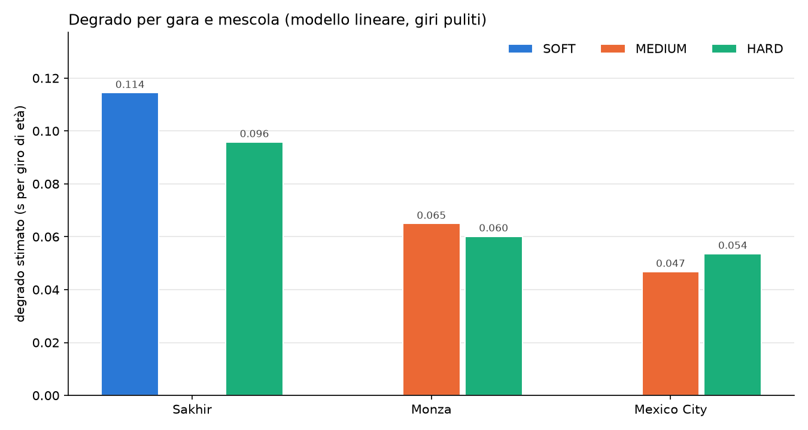

# F1 Tyre Strategy

Modello del degrado delle gomme di Formula 1 e simulatore delle strategie di sosta, con i dati pubblici di [OpenF1](https://openf1.org).

## Il problema

In gara la strategia ai box si decide in buona parte sul **degrado**: quanti decimi perde una gomma a ogni giro.
Se una mescola degrada poco conviene allungare lo stint e fermarsi una volta sola. Se degrada molto, una sosta in più
(circa 20-25 s) può valere la pena. Il tempo sul giro però dipende da molte altre cose: carburante, traffico,
safety car, pioggia, pilota. Il lavoro sta nel separare l'effetto della gomma da tutto il resto e nel capire
quanto ci si può fidare del risultato.

## I dati

- **Fonte**: API pubblica [OpenF1](https://openf1.org) (giri, stint, meteo, messaggi di race control).
  Nel repository c'è lo **script che scarica i dati**, non i dati: `python scripts/01_scarica_dati.py` li salva in `data/`.
- **Gare candidate (2023)**: Sakhir, Monte Carlo, Catalunya, Monza, Mexico City.
- **Gare usate**: Sakhir, Monza, Mexico City.
  - Monte Carlo è esclusa in automatico perché ha pioggia nel 15% delle misure meteo e il modello è solo per l'asciutto.
  - Catalunya: quando ho scaricato i dati l'API rispondeva 401. Lo script la salta con un messaggio e la include
    da sola quando torna disponibile.

## Il metodo

**1. Pulizia** (`src/clean.py`). Per ogni gara si tolgono, nell'ordine:
giri senza tempo, giri di uscita e di rientro dai box, giro 1, giri con bandiere gialle,
giri lenti per tutto il gruppo (safety car, VSC, transizione meteo: mediana del gruppo oltre il 3% sopra il passo
asciutto), e gli outlier del singolo pilota (oltre il 2,5% sopra la mediana mobile del suo stint).
L'età della gomma vale 0 nel primo giro dello stint. Lo script 02 stampa la tabella degli scarti per ogni gara:

| Gara | Giri scaricati | Giri puliti |
|---|---|---|
| Sakhir | 1058 | 843 |
| Monza | 968 | 876 |
| Mexico City | 1286 | 1080 |

**2. Modello del degrado** (`src/models.py`), uno per gara:

```
tempo_giro = passo[mescola] + degrado[mescola] × età_gomma + carburante × numero_giro
```

È lineare di proposito. Ogni coefficiente ha un significato (secondi, secondi per giro di età, secondi per giro di gara),
il tempo cresce sempre con l'età e i controlli si fanno cambiando un numero. Un gradient boosting provato prima dava
curve non monotone (una gomma di 40 giri "più veloce" di una di 15) e l'ottimizzatore approfittava di quel rumore.
Le mescole con meno di 50 giri puliti o meno di 3 piloti non vengono stimate.

**3. Validazione per gruppi.** I giri di uno stesso stint si somigliano, quindi una divisione casuale train/test
darebbe un errore troppo ottimista. Ogni modello viene allenato su tutte le gare tranne una e testato su quella
(*leave-one-group-out*). Il confronto è con una **baseline** che prevede sempre la mediana.

**4. Simulatore** (`src/simulate.py`):
- **Perdita per sosta**: mediana, su tutte le soste "pulite", di (giro di rientro − riferimento) + (giro di uscita − riferimento).
  Il riferimento è la mediana degli ultimi 5 giri puliti del pilota. Le soste con safety car, VSC o bandiere vengono scartate.
- **Ottimo**: ricerca esaustiva di giri di sosta e mescole con 1 e 2 soste. Vincoli: regola delle due mescole,
  stint di almeno 5 giri, età della gomma non oltre la massima osservata nei dati.
- **Controlli di buon senso**: quattro proprietà che il simulatore deve rispettare. Per esempio, con degrado zero
  2 soste devono costare esattamente 1 sosta + una perdita. Vengono verificate a ogni esecuzione.
- **Back-testing**: simula le strategie reali dei piloti e le confronta con l'ottimo e con i tempi reali.

## Risultati

### Degrado per gara e mescola



| Gara | Mescola | Degrado (s/giro di età) | Giri | Piloti |
|---|---|---|---|---|
| Sakhir | SOFT | 0.114 | 325 | 20 |
| Sakhir | HARD | 0.096 | 510 | 19 |
| Monza | MEDIUM | 0.065 | 402 | 19 |
| Monza | HARD | 0.060 | 474 | 19 |
| Mexico City | MEDIUM | 0.047 | 596 | 19 |
| Mexico City | HARD | 0.054 | 477 | 19 |

Sakhir, con asfalto abrasivo e caldo, ha il degrado più alto. Attenzione: SOFT/MEDIUM/HARD sono nomi *relativi*,
perché Pirelli porta compound diversi su ogni circuito. Il confronto va quindi fatto per circuito.

### Validazione "una gara fuori" (MAE in secondi, tempi relativi alla mediana di gara)

| Modello | fuori Sakhir | fuori Monza | fuori Mexico City | Medio |
|---|---|---|---|---|
| baseline (mediana) | 1.012 | **0.599** | 0.857 | 0.823 |
| lineare (passo + degrado per mescola) | 0.871 | 0.730 | **0.708** | **0.769** |
| gradient boosting | **0.827** | 0.773 | 0.800 | 0.800 |

In media il lineare batte la baseline, ma **non su Monza**: il degrado imparato sulle altre gare non si trasferisce.
Il degrado dipende dal circuito, ed è per questo che il simulatore usa un modello per gara.
Il gradient boosting non fa meglio del lineare: con questi dati la complessità in più non serve.

### Strategie e back-testing

| Gara | Perdita per sosta | Strategia ottima | Primo arrivato: gap dall'ottimo | Errore modello (giri puliti) | Differenza tra strategie reali (10°-90° perc.) |
|---|---|---|---|---|---|
| Sakhir | 23.3 s | SOFT(17) > HARD(37) > HARD | +9.3 s | 0.62 s/giro | 7.4 s |
| Monza | 24.1 s | MEDIUM(24) > HARD | +1.0 s | 0.48 s/giro | 15.5 s |
| Mexico City | 21.4 s | HARD(21) > MEDIUM(46) > MEDIUM | −8.7 s | 0.69 s/giro | 25.4 s |

- **Monza**: il vincitore (MEDIUM fino al giro 20, poi HARD) è a 1 s dall'ottimo simulato.
- **Sakhir**: una sosta sola è impossibile con le età massime osservate (HARD 28, SOFT 23 giri su 57).
- **Mexico City**: 1 e 2 soste differiscono di 1.1 s, molto meno dell'errore del modello, quindi è un pareggio.
  Il vincitore risulta "più veloce dell'ottimo" perché ha cambiato gomme gratis durante la bandiera rossa.
- Tutti e 4 i controlli di buon senso sono superati in tutte e 3 le gare.

## Limitazioni

- **Pochi dati**: 3 gare asciutte, e su ogni gara solo due mescole hanno abbastanza giri.
- **Errore sulla gara intera**: il tempo totale simulato sbaglia di circa 25 s rispetto alla realtà (Sakhir, Monza).
  È più della differenza tra le strategie. Gran parte dell'errore è il passo del pilota, che è circa lo stesso con
  qualsiasi strategia, quindi il confronto *tra strategie* è più affidabile del tempo assoluto. Resta comunque un limite.
- **Traffico**: il simulatore considera un pilota che gira da solo. Undercut e overcut richiederebbero due piloti insieme.
- **Safety car**: una sosta in regime di safety car costa meno, ma il simulatore usa sempre la stessa perdita.
- **Meteo**: il modello è allenato solo su gare e fasi asciutte.
- **Carburante**: il numero di giro è un sostituto e contiene anche l'evoluzione della pista.
- **Gomme**: il simulatore parte sempre da gomme nuove. Il giro di uscita con gomme fredde è assorbito nella perdita per sosta.
- **Mescole relative**: la stessa etichetta indica gomme diverse su circuiti diversi.

## Come rieseguirlo

Python 3.13.

```bash
python -m venv .venv
source .venv/bin/activate
pip install -r requirements.txt

python scripts/01_scarica_dati.py   # scarica da OpenF1 in data/ (cache: i file presenti non si riscaricano)
python scripts/02_pulisci.py        # giri puliti + tabella degli scarti -> data/giri_puliti_*.csv, data/scarti_*.csv
python scripts/03_modelli.py        # degrado per gara + validazione -> data/degrado_per_gara.csv, figures/degrado_per_gara.png
python scripts/04_strategia.py      # perdita per sosta, ottimo, controlli, back-testing -> data/riepilogo_strategie.csv
```

Ogni numero di questo README è stampato da uno degli script.

### Struttura

```
src/
  data.py       download da OpenF1 con cache su file
  clean.py      regole di pulizia, età della gomma, tabella degli scarti
  models.py     modello del degrado, validazione una gara fuori, baseline, grafico
  simulate.py   perdita per sosta, simulatore, controlli di buon senso, back-testing
scripts/        i 4 passi, da lanciare in ordine
notebooks/      journey.py: l'esplorazione iniziale su Monte Carlo 2023 (genera gli altri grafici in figures/)
figures/        grafici salvati
data/           non nel repository (si ricrea con lo script 01)
```

## Cosa farei dopo

- Più gare e più stagioni, per stimare tutte e tre le mescole su ogni circuito.
- Un **intervallo di confidenza** sul degrado (bootstrap per pilota o per stint) e una prova di sensibilità sulle soglie di pulizia.
- Un termine per il **passo del pilota**, così da ridurre l'errore sul tempo di gara.
- Perdita per sosta ridotta in regime di safety car e simulazione con probabilità di safety car.
- Partenza con gomme usate e qualche test automatico (`pytest`) sulle parti delicate: età della gomma, giro di rientro, unione con il meteo.
